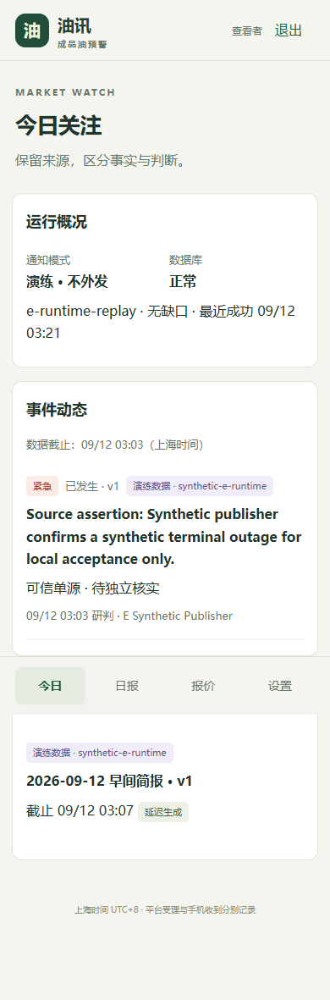

<div align="center">

# Oil Agent

Refined-oil news monitoring where every alert keeps its evidence, and nothing leaves the machine without a typed permission that names the recipient.

成品油资讯监测：每条预警都保留自己的证据，而没有一条消息会在缺少"指名收件人的类型化权限"时离开这台机器。

[](https://github.com/songconmaisaix31-design/oil-agent/actions/workflows/acceptance.yml)
[](pyproject.toml)
[](deploy/compose.yaml)
[](LICENSE)



<sub>A 390 px view captured during the recorded synthetic rehearsal — every item on the page is labelled 演练数据 (exercise data).<br/>录制复演里的 390 px 页面，页面上每一项都标注了「演练数据」。</sub>

</div>

> **How to read this page / 怎么读这页**
> English first, then the same content in Chinese — not a summary, not a separate version. Tables keep both languages in one cell.
> 每段英文在前，同一内容的中文紧跟在后；不是摘要，也没有单独的中文版。表格把两种语言放进同一格。

---

## At a glance · 一眼看懂

| | |
|---|---|
| **Problem<br/>问题** | A monitoring product fails in two directions: it misses the alert that mattered, or it forwards something that reads like a terminal outage but was a planning notice. Both failures are cheap to hide and expensive to debug after the fact.<br/>监测产品会在两个方向上出错：该到的预警没到，或者把一条"计划检修"的通知当成"已经停产"转发出去。这两种错都容易掩盖，事后排查却很贵。 |
| **Fix<br/>做法** | Immutable source revisions, assessments that cite their evidence, a transactional outbox with three queues, per-recipient and per-revision acknowledgement, and a delivery path that needs a separate typed permission for each capability.<br/>不可变的源修订、带证据的评估、三队列的事务性 outbox、按收件人与修订分别回执，以及每条能力都要单独一份类型化权限才能发送的投递路径。 |
| **Cost<br/>代价** | Python 3.13 and uv 0.11.26, a PostgreSQL database you provision yourself, and Node 24 for the mobile client. Four processes: the API plus three queue workers.<br/>Python 3.13 与 uv 0.11.26、一台自己申请的 PostgreSQL、以及给手机端用的 Node 24。四个进程：API 加三个队列 worker。 |
| **Not<br/>不是** | Not a trading system, not a hosted alerting service, and not production-ready: the production assembly is not implemented and rejects startup.<br/>不是交易系统、不是托管告警服务，也不是生产就绪的：生产装配没有实现，启动时会直接拒绝。 |

## The problem · 问题在哪

The hard part is not fetching news. It is keeping four things attached to every alert: which source revision it came from, which approved rule fired, which sentences in the source support it, and who is allowed to receive it this week.

难的部分不是抓新闻，而是让每条预警始终带着四样东西：来自哪一次源修订、命中了哪条已批准的规则、原文里哪几句话支撑它、以及这周谁有权限收到它。

Two failure modes drive the design. First, a keyword match is not an event: the repository's R16 repair is specifically about separating complete casualty-only negative predicates from affirmative event or impact evidence, so "no casualties were reported" cannot become "casualties reported". Second, a send that is ambiguous is not a send that failed — a retry can duplicate a message that already went out.

两个失效场景决定了设计。第一，关键词命中不等于事件：仓库里的 R16 修复专门处理"完整的仅伤亡否定句"与"肯定的事件/影响证据"的分离，避免"未报告伤亡"变成"报告了伤亡"。第二，状态不明的发送不等于发送失败——重试可能把已经发出去的消息再发一遍。

The codebase treats both as data-shape problems rather than prompt problems: rules carry their criteria, assessments carry evidence links, delivery carries a per-recipient revision, and an ambiguous provider reply is stored as `UNKNOWN` instead of being retried blindly.

代码把这两件事都当数据结构问题而不是提示词问题：规则带着判据，评估带着证据链接，投递带着按收件人的修订号，上游回复不明确时存成 `UNKNOWN`，而不是盲重试。

## The idea · 思路

| Noun · 名词 | Where · 位置 | Rule · 规则 |
|---|---|---|
| **Source revision**<br/>源修订 | `src/oil_agent/ingestion/`, `storage/migrations/` | Stored immutably; a correction is a new revision linked to the original, not an overwrite.<br/>不可变存储；修正是关联原记录的新修订，不是覆盖。 |
| **Assessment**<br/>评估 | `src/oil_agent/intelligence/`, `contracts/` | Linked to evidence. Model output cannot grant severity, provenance or send permission.<br/>与证据绑定。模型输出不能授予严重度、来源档位或发送权限。 |
| **Queue split**<br/>队列划分 | `runtime/`, Procrastinate | `ingest`, `urgent` and `normal` are separate queues with separate workers.<br/>`ingest`、`urgent`、`normal` 是分开的队列，各有独立 worker。 |
| **Outbox**<br/>发件箱 | `storage/` | The outbox row and the state change commit in the same transaction.<br/>outbox 记录与状态变更在同一个事务里提交。 |
| **Permission**<br/>权限 | `config/real-integration-contract.md`, permissions module | Each capability — source, model, identity, send — needs its own typed permission, validity window and project scope.<br/>每条能力（源、模型、身份、发送）都要各自的类型化权限、有效期与项目范围。 |
| **Provenance**<br/>来源档位 | `bootstrap.py`, fixtures | `fixture`, `trial` and `production` are distinct labels and never blend.<br/>`fixture`、`trial`、`production` 是互不混用的三个标签。 |

The check a reader can run immediately: start the default runtime and watch it create nothing. No users, no recipients, no source subscriptions, no sample rows — the factory refuses to invent state.

读者可以立刻验证的一件事：用默认配置启动，然后看它什么都不建。没有用户、没有收件人、没有源订阅、没有样例数据——工厂不会凭空造状态。

## Capabilities · 能力清单

| Area · 部分 | Modules · 模块 | What is implemented · 已实现什么 |
|---|---|---|
| Ingestion<br/>接入 | `ingestion/` | Jin10 MCP over HTTPS with schema discovery and revision adaptation; CSV/XLSX preview and idempotent import; a 2,000,000-byte raw upload cap; Decimal comparison on matching quote bases.<br/>Jin10 MCP 走 HTTPS，带 schema 发现与修订适配；CSV/XLSX 预览与幂等导入；原始上传上限 2,000,000 字节；报价按同一基价做 Decimal 比较。 |
| Intelligence<br/>研判 | `intelligence/`, `contracts/` | Bounded LangGraph processing, approved-rule rubric, contextual guards, freshness bound that tolerates a short midnight crossing, stale-news protection.<br/>有界的 LangGraph 处理、已批准规则判据、上下文护栏、容许短暂跨零点的新鲜度界限、旧闻保护。 |
| Storage<br/>存储 | `storage/`, `alembic.ini` | PostgreSQL via SQLAlchemy, Alembic migrations, checkpoints and the transactional outbox.<br/>SQLAlchemy 访问 PostgreSQL、Alembic 迁移、检查点与事务性 outbox。 |
| Channel<br/>渠道 | `channels/` | Scoped Feishu OAuth, send and per-recipient/per-revision acknowledgement; a dry-run channel as the default.<br/>有范围的飞书 OAuth、发送与按收件人/修订回执；默认走 dry-run 渠道。 |
| Reporting<br/>报告 | `reporting/` | Daily reports whose claims stay linked to the evidence that produced them.<br/>每日报告里的结论仍指向产生它的证据。 |
| API<br/>接口 | `api/` | FastAPI app factory `oil_agent.bootstrap:create_app`; `/api/v1` routes for session, events (with acknowledgement and feedback), reports, config and status.<br/>FastAPI 应用工厂 `oil_agent.bootstrap:create_app`；`/api/v1` 下提供 session、事件（含回执与反馈）、报告、配置与状态路由。 |
| Web<br/>前端 | `web/` | React 19 + Vite Chinese mobile views for events, evidence, reports, quotes, settings and feedback; API types generated from the committed OpenAPI document and checked during the build.<br/>React 19 + Vite 的中文手机视图：事件、证据、报告、报价、设置、反馈；API 类型由提交的 OpenAPI 文档生成，构建时校验。 |
| Deploy<br/>部署 | `deploy/` | Compose files for local, isolated-database and trial overlays; two Dockerfiles; Nginx configs; scoped backup and isolated-restore scripts.<br/>本机、隔离数据库与试运行 overlay 的 Compose 文件；两个 Dockerfile；Nginx 配置；有范围的备份与隔离恢复脚本。 |

## Quickstart · 快速开始

### Requirements · 环境要求

Python 3.13, uv 0.11.26, PostgreSQL, and Node 24 for `web/`. Allocate a database yourself and inject `OIL_DATABASE_URL` with the `postgresql+psycopg` driver — no dotenv file and no stored credential is loaded automatically.

Python 3.13、uv 0.11.26、PostgreSQL，以及 `web/` 用的 Node 24。数据库要自己申请，并显式注入使用 `postgresql+psycopg` 驱动的 `OIL_DATABASE_URL`——不会自动读 dotenv 文件，也不读保存的凭据。

### 1. Sync and migrate · 同步与迁移

```sh
uv sync --locked
uv run --locked python -m oil_agent.runtime.cli migrate
uv run --locked python -m oil_agent.runtime.cli queue-schema
uv run --locked python -m oil_agent.runtime.cli recover
```

`recover` clears interrupted work left by a previous stop; the other two apply the schema and the queue tables.

`recover` 清理上一次停止留下的中断任务；另两条建表和应用队列结构。

### 2. Serve and work · 启动与执行

```sh
uv run --locked uvicorn oil_agent.bootstrap:create_app --factory --host 127.0.0.1 --port 8000
```

Run each queue in its own terminal — the API and the workers share `oil_agent.bootstrap:build_runtime`:

每个队列单独开一个终端——API 与 worker 共用 `oil_agent.bootstrap:build_runtime`：

```sh
uv run --locked python -m oil_agent.runtime.cli worker --queue ingest
uv run --locked python -m oil_agent.runtime.cli worker --queue urgent
uv run --locked python -m oil_agent.runtime.cli worker --queue normal
```

### 3. Verify · 验证

```sh
uv run --locked python scripts/validate_scenario_corpus.py
uv run --locked pytest tests/contracts tests/unit -m 'not postgres' -q
uv run --locked pytest tests/integration -q      # needs OIL_E_TEST_DATABASE_URL · 需要注入该变量
cd web && npm ci --ignore-scripts && npm test && npm run build
```

The scenario checker reads fixed synthetic cases and does consistency checks only — its pass is not an application acceptance. The integration command skips PostgreSQL cases loudly when `OIL_E_TEST_DATABASE_URL` is missing; a skipped run is not PostgreSQL acceptance.

样例校验器只读固定的合成场景做一致性检查——它通过不等于应用验收通过。缺少 `OIL_E_TEST_DATABASE_URL` 时集成测试会显式跳过 PostgreSQL 用例；跳过不等于 PostgreSQL 已验收。

## Documentation · 文档

| Doc · 文档 | Read it when · 什么时候读 |
|---|---|
| [docs/runbook.md](docs/runbook.md) | Operations: factory selection, trial assembly, isolation, backup and restore, external gates.<br/>运维：工厂选择、试用装配、隔离、备份恢复、外部闸门。 |
| [config/real-integration-contract.md](config/real-integration-contract.md) | The permission contract: exact fields for each capability and its validity window.<br/>权限契约：每条能力的字段与有效期。 |
| [config/oil-event-rules.example.json](config/oil-event-rules.example.json) | A rule set with `rules_ref` as `authorization_ref@version`.<br/>以 `authorization_ref@version` 作为 `rules_ref` 的规则集示例。 |
| [deploy/controlled-trial.md](deploy/controlled-trial.md) | The opt-in trial overlay, isolated database, loopback HTTPS, read-only checks.<br/>可选的试运行 overlay、隔离数据库、回环 HTTPS、只读检查。 |
| [config/integration-handoff.md](config/integration-handoff.md) | Producer commits, commands, scope and branch verification.<br/>生产者提交、命令、范围与分支核对。 |
| [e2e/runtime-checks.md](e2e/runtime-checks.md) | The recorded runtime checks, including what each one does not prove.<br/>复演记录，包含每一项各不证明什么。 |
| [e2e/baseline-checks.md](e2e/baseline-checks.md) | The pre-trial baseline.<br/>试运行前的基线检查。 |
| [fixtures/README.md](fixtures/README.md) | Scenario fixtures and the runtime factory.<br/>场景样例与运行时工厂。 |
| [web/README.md](web/README.md) | Mobile client conventions and its local commands.<br/>手机端约定与本地命令。 |
| [.env.example](.env.example) | Every `OIL_*` switch, including the daily and urgent model/source limits.<br/>全部 `OIL_*` 开关，含每日与紧急的模型/数据源限额。 |

## Repository layout · 仓库结构

```text
oil-agent/
├── src/oil_agent/
│   ├── bootstrap.py        # build_runtime / create_app — the only factory pair
│   ├── api/                # FastAPI routes under /api/v1
│   ├── ingestion/          # Jin10 transport, CSV/XLSX import, quote comparison
│   ├── intelligence/       # bounded LangGraph processing, rules, guards
│   ├── channels/           # Feishu OAuth/send/ack, dry-run channel
│   ├── reporting/          # evidence-linked daily reports
│   ├── runtime/            # cli: migrate, queue-schema, recover, worker
│   ├── storage/            # SQLAlchemy models, migrations, outbox, checkpoints
│   └── contracts/          # OpenAPI document and shared schemas
├── web/                    # React 19 + Vite mobile client, generated API types
├── tests/                  # contracts / integration / unit
├── deploy/                 # Compose overlays, Dockerfiles, Nginx configs
├── e2e/                    # recorded runtime checks and their artifacts
├── fixtures/               # fixed synthetic scenarios + runtime factory
├── scripts/                # backup, restore, controlled trial, validators
└── .github/workflows/      # acceptance.yml, controlled-trial.yml
```

## Status · 状态

Version 0.1.0. What exists and what it has been exercised against:

版本 0.1.0。存在什么、以及被什么验证过：

- **CI is real.** `acceptance.yml` runs on push and pull requests with two isolated PostgreSQL 16 services and a 20-minute timeout; `controlled-trial.yml` runs the deployment-preparation checks, Ruff, the trial safety tests, `bash -n` on the start script, and an Nginx TLS configuration check in a network-isolated container.
- **79 test modules**: 3 contract, 27 integration, 49 unit, plus `conftest.py`. The web client has one vitest file (`web/src/test/app.test.tsx`) and a `browser:check` script.
- **The synthetic chain is exercised end to end**: synthetic-provider tests drive the real adapters and the PostgreSQL runtime. That is not evidence of live provider access, platform acceptance or phone receipt.
- **Two workflows, no scheduler**: there are exactly two CI workflows; the product has no agent scheduler, which is an explicit non-goal in `AGENTS.md`.

- **CI 是真实的。** `acceptance.yml` 在 push 和 PR 上跑，带两个隔离的 PostgreSQL 16 服务，超时 20 分钟；`controlled-trial.yml` 跑部署准备检查、Ruff、试运行安全测试、对启动脚本做 `bash -n`，并在断网容器里检查 Nginx 的 TLS 配置。
- **79 个测试模块**：3 个 contract、27 个 integration、49 个 unit，另有 `conftest.py`。前端有 1 个 vitest 文件（`web/src/test/app.test.tsx`）和一个 `browser:check` 脚本。
- **合成链路是端到端跑过的**：合成提供方测试驱动真实适配器与 PostgreSQL 运行时。这不构成真实上游访问、平台接收或手机送达的证据。
- **两个工作流、没有调度器**：CI 只有两个工作流；产品里没有 Agent 调度器，`AGENTS.md` 把它列为明确的非目标。

Known limits, stated rather than hidden:

边界写出来而不是藏起来：

- **No live integration.** Real source calls, model calls, Feishu login and phone delivery all require external authorization that was never granted. Every one of them is unverified / 未验证.
- **Production assembly is not implemented** and rejects startup; the default is fixture/dry-run with no subscriptions.
- **Test totals are not restated here.** The previous README cited specific Actions run IDs and passed-test totals for particular commits; those runs were not re-opened in this pass, so no totals are carried over.
- **Single-host Compose.** Deployment is Linux Compose with loopback Nginx; TLS trust, callbacks, load/SLA and off-host recovery are untested.
- **It does not execute trades.** The delivery board with the remaining gates lives in the repository root as one large task file.

- **没有真实集成。** 真实数据源调用、模型调用、飞书登录和手机送达都需要从未获得的外部授权。这些全部是未验证 / not verified。
- **生产装配没有实现**，启动时会拒绝；默认是 fixture/dry-run，没有任何订阅。
- **这里不复述测试总数。** 旧 README 引用过具体 Actions run 编号和通过数；本轮没有重新打开那些运行，所以不把总数搬过来。
- **单机 Compose。** 部署是 Linux Compose 加回环 Nginx；TLS 信任、回调、负载/SLA 和异地恢复都没有验证。
- **它不执行交易。** 剩余闸门的交付看板在仓库根目录，是一份很大的任务文件。

## License · 许可

MIT © 2026 DaV1d W
